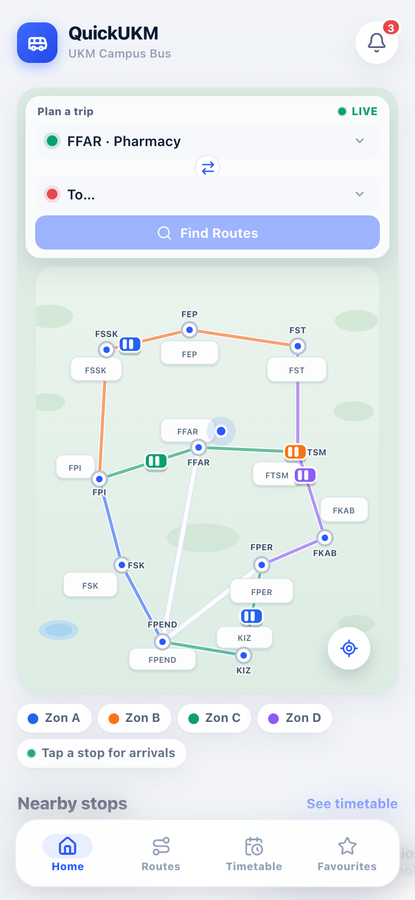
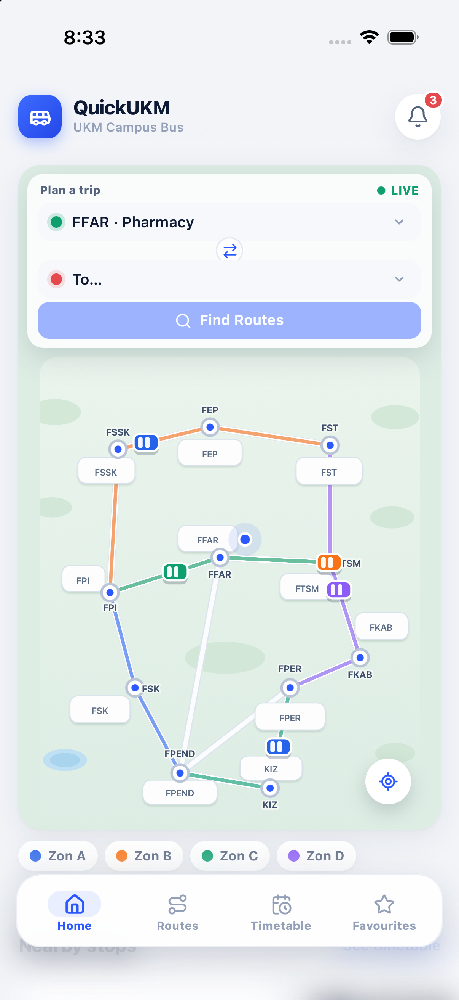

# QuickUKM — UKM Campus Bus

A mobile-first campus bus companion prototype for international students at
Universiti Kebangsaan Malaysia (UKM Bangi). The frontend is built with
**React + Vite** and is wrapped as an **iPhone app** with SwiftUI + WKWebView.

All bus positions, ETAs, schedules and alerts are **simulated** — there is no
backend, login, real GPS or official UKM data.

**Live demo:** <https://a215445-coder.github.io/quickukm/>

| Web | iPhone |
| --- | --- |
|  |  |

## Features

- **Home** — stylised UKM campus map with simulated moving buses, quick trip
  planner, zone legend, nearby stops and popular routes.
- **Routes** — from/to selection, swap, direct and transfer options, walking
  times, per-stop timeline and a simulated **Start Navigation** flow with
  step-by-step walking/boarding/riding guidance.
- **Timetable** — filter by Zon A–D, expandable cards and next departures.
- **Favourites** — save trips; they persist in `localStorage`.
- **Arrival Alerts** — simulated notification feed, master switch and a
  "simulate a notification" demo button.
- **iPhone app** — the whole frontend is bundled offline inside
  `ios/QuickUKM/www/index.html`; no server is required on the phone.

## Tech stack

- React 18, Vite 6, `lucide-react`
- Plain CSS with mobile safe-area support (`env(safe-area-inset-*)`)
- SwiftUI + WKWebView iOS shell
- PWA manifest, icons and add-to-home metadata

## Run the web app

```bash
npm install
npm run dev
```

- Desktop: <http://localhost:5173>
- Phone on the same Wi-Fi: `http://<your-laptop-ip>:5173`
  (`ipconfig getifaddr en0` on macOS)

Production build:

```bash
npm run build -- --base=./
```

## Run on iPhone

Open the Xcode project:

```bash
open ios/QuickUKM.xcodeproj
```

Select your development team and connected iPhone, then press **Run**. The
project is preconfigured with the original author's team — choose your own team
and bundle identifier when building with a different Apple ID.

Command-line install:

```bash
xcrun devicectl list devices        # copy the iPhone UDID
./ios/install.sh <device-udid>
```

The free personal-team signature lasts 7 days; re-run to refresh it. See
[`ios/README.md`](ios/README.md) for details and the “Untrusted Developer”
instructions.

To refresh the bundled web app after editing the React source:

```bash
./ios/sync-web.sh
```

## Project structure

```text
.
├── index.html              Vite entry
├── src/
│   ├── App.jsx             tabs, favourites, alerts, plan state
│   ├── components/         map, navigation sheet, bottom nav, stop select
│   ├── pages/              Home, Routes, Timetable, Favourites, Alerts
│   ├── data/               simulated routes, stops and schedules
│   └── index.css           full mobile UI
├── public/                 PWA manifest and icons
├── ios/                    Xcode + WKWebView wrapper
├── docs/
│   ├── PROJECT.md          problem, users, features, demo flow
│   └── screenshots/        web and iPhone screenshots
└── package.json
```

## Documentation

- [Project brief & demo flow](docs/PROJECT.md)
- [iOS build notes](ios/README.md)

## Notes

- Prototype only: simulated data, no official UKM service, no real-time API.
- Visual direction is inspired by Malaysian transit apps such as MyRapid; the
  QuickUKM interface and assets are original.
- Favourites and the alert switch are stored locally on each device.
- The original single-page static prototype is preserved in the
  `legacy-static-site` branch for reference.

## License / attribution

This is a student prototype. UKM and MyRapid names are used only for context;
no affiliation is implied.
