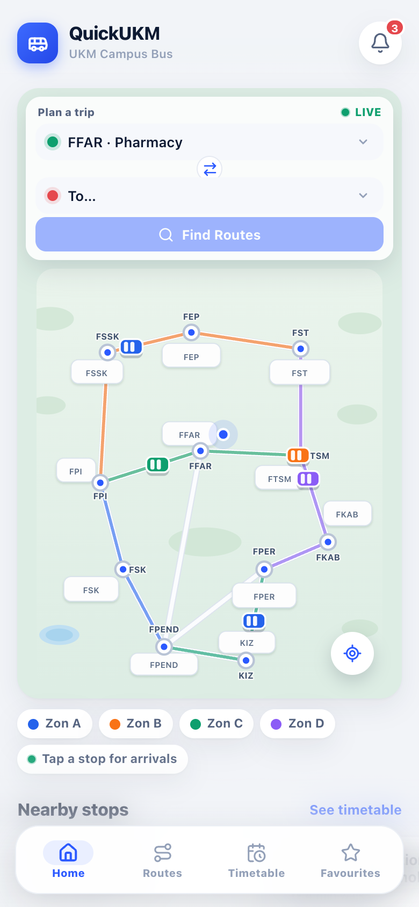
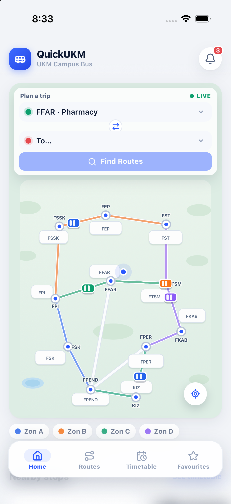

# QuickUKM — UKM Campus Bus

A mobile-first campus bus companion prototype for international students at
Universiti Kebangsaan Malaysia (UKM Bangi). The frontend is built with
**React + Vite** and is wrapped as an **iPhone app** with SwiftUI + WKWebView.

The offline Bangi map uses roads, buildings and landmarks from
[OpenStreetMap contributors](https://www.openstreetmap.org/copyright) (ODbL).
Solid markers indicate mapped stops. Hollow markers indicate approximate stop
areas, and unlocated stops appear in the written itinerary only. Road overlays
are estimates based on the mapped road network.

The route lists and typical hours are a snapshot checked on 20 November 2026:
[Zon 1](https://moovitapp.com/index/en/public_transit-line-zon_1-Kuala_Lumpur-1082-1248041-204608212-0),
[Zon 2](https://moovitapp.com/index/en/public_transit-line-ZON_2-Kuala_Lumpur-1082-1248041-775192-0),
[Zon 3](https://moovitapp.com/index/en/public_transit-line-zon_3_4-Kuala_Lumpur-1082-1248041-204608213-0)
and [Zon 4](https://moovitapp.com/index/en/public_transit-line-zon_3_4-Kuala_Lumpur-1082-1248041-204608213-1).
For live locations and arrivals, UKM provides [MyUKM Smart Bus](https://www.ukm.my/kelestarian/sdgukm2024/sdg11/11-4-2/).

**Live demo:** <https://a215445-coder.github.io/quickukm/>

| Web | iPhone |
| --- | --- |
|  |  |

## Features

- **Home** — campus map, shuttle zones, stop details and trip planning.
- **Routes** — direct options and one-transfer planning using published stop orders,
  with a manual route preview.
- **Timetable** — regular service days, operating hours and links to published departures.
- **Favourites** — save trips locally using the updated route data.
- **Service Updates** — open UKM’s tracker for current bus information.
- **iPhone app** — the whole frontend is bundled offline inside
  `ios/QuickUKM/www/index.html`; no server is required on the phone.

## Tech stack

- React 18, Vite 6, `lucide-react`
- Plain CSS with mobile safe-area support (`env(safe-area-inset-*)`)
- SwiftUI + WKWebView iOS shell
- PWA manifest, icons and add-to-home metadata

## Run the web app

```bash
npm install
npm run dev
```

- Desktop: <http://localhost:5173>
- Phone on the same Wi-Fi: `http://<your-laptop-ip>:5173`
  (`ipconfig getifaddr en0` on macOS)

Production build:

```bash
npm run build -- --base=./
```

## Run on iPhone

Open the Xcode project:

```bash
open ios/QuickUKM.xcodeproj
```

Select your development team and connected iPhone, then press **Run**. The
project is preconfigured with the original author's team — choose your own team
and bundle identifier when building with a different Apple ID.

Command-line install:

```bash
xcrun devicectl list devices        # copy the iPhone UDID
./ios/install.sh <device-udid>
```

The free personal-team signature lasts 7 days; re-run to refresh it. See
[`ios/README.md`](ios/README.md) for details and the “Untrusted Developer”
instructions.

To refresh the bundled web app after editing the React source:

```bash
./ios/sync-web.sh
```

## Project structure

```text
.
├── index.html              Vite entry
├── src/
│   ├── App.jsx             tabs, favourites, alerts, plan state
│   ├── components/         map, navigation sheet, bottom nav, stop select
│   ├── pages/              Home, Routes, Timetable, Favourites, Alerts
│   ├── data/               published stop sequences, service hours and map geometry
│   └── index.css           full mobile UI
├── public/                 PWA manifest and icons
├── ios/                    Xcode + WKWebView wrapper
├── docs/
│   ├── PROJECT.md          problem, users, features, demo flow
│   └── screenshots/        web and iPhone screenshots
└── package.json
```

## Documentation

- [Project brief & demo flow](docs/PROJECT.md)
- [iOS build notes](ios/README.md)

## Notes

- QuickUKM is an independent student project and uses published reference data.
- Visual direction is inspired by Malaysian transit apps such as MyRapid; the
  QuickUKM interface and assets are original.
- Favourites are stored locally on each device.
- The original single-page static prototype is preserved in the
  `legacy-static-site` branch for reference.

## License / attribution

This is a student prototype. UKM and MyRapid names are used only for context;
no affiliation is implied.
